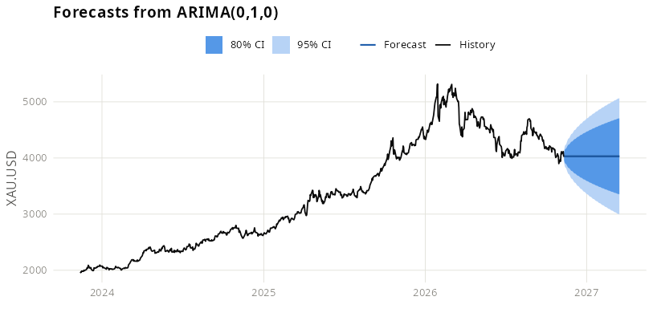

[](https://github.com/EnriquePH/Precious-Metals-Prediction/actions/workflows/r-ci.yml)
[](https://www.gnu.org/licenses/gpl-3.0)
[](https://www.r-project.org/)
[](https://lintr.r-lib.org/)
[](#running-locally)
[](CITATION.cff)
[](https://github.com/EnriquePH/Precious-Metals-Prediction/releases)
[](https://github.com/EnriquePH/Precious-Metals-Prediction/releases)
[](https://github.com/EnriquePH/Precious-Metals-Prediction/issues)
[](https://github.com/EnriquePH/Precious-Metals-Prediction/commits)

# Precious Metals Price ARIMA Forecast

## Coursera - Developing Data Products

* Author:  Enrique Pérez Herrero
* Date: 20/Dec/2016
* [Email](mailto:eph.project1500@gmail.com)
* [GNU GENERAL PUBLIC LICENSE Version 3, 29 June 2007](https://github.com/EnriquePH/Precious-Metals-Prediction)
* [GitHub url](https://github.com/EnriquePH/Precious-Metals-Prediction)
* [Slidify url](http://enriqueph.github.io/Precious-Metals-Slidify/)

## Description:
The app downloads the last three years of daily prices of the COMEX/NYMEX
front-month futures from [Yahoo Finance](https://finance.yahoo.com) (in USD,
converted to EUR and GBP with each day's exchange rate) and forecasts the next
90 trading days using the `auto.arima` function from the `forecast` R package.

All plots share one visual language (`theme_metals()` in
[helpers.R](helpers.R)): dark ink for observed history, a single blue hue for
model output, and — since the forecast's 80%/95% confidence bands are a
magnitude encoding, not two unrelated categories — two steps of that *same*
hue (darker/narrower = 80%, lighter/wider = 95%), with a legend identifying
all four elements.

Those `ggplot2` objects are the single source of truth for every plot: in
the running app they're wrapped with `plotly::ggplotly()` for interactive,
zoomable charts, while the same objects are used unwrapped to render the
static PNG/PDF report images (like the one below).



## Instructions:
[Project gh-pages](http://enriqueph.github.io/Precious-Metals-Prediction/)

## Shiny server Url:
The app is no longer hosted on shinyapps.io (it was at
`kikesoft.shinyapps.io/Precious-Metals-Prediction`); it downloads its prices
from the internet at start-up, so run it locally (below).

## Running locally

```r
install.packages(c(
  "shiny", "shinythemes", "DT", "markdown",
  "TTR", "quantmod", "ggplot2", "plotly", "patchwork", "forecast", "zoo"
))
```

```sh
Rscript run.R
# or: SHINY_PORT=8080 SHINY_HOST=0.0.0.0 Rscript run.R
```

`run.R` just calls `shiny::runApp(".")` under the hood; port/host default to
`3838`/`127.0.0.1` and are overridable via the `SHINY_PORT`/`SHINY_HOST` env
vars. Equivalent from an R console: `shiny::runApp(".")`.

## PDF reports

Requires the [Quarto CLI](https://quarto.org/docs/get-started/) and the R
`quarto` and `knitr` packages, plus a LaTeX install (e.g. via
`tinytex::install_tinytex()`) for PDF rendering.

```sh
Rscript report_usd.R   # reports/metals-report-usd.pdf
Rscript report_eur.R   # reports/metals-report-eur.pdf
```

Both scripts render [report-template.qmd](report-template.qmd) — a
`quarto::quarto_render()` call parameterized with `currency` — into a
one-section-per-metal PDF covering every metal in
[`precious_metals`](helpers.R) for that currency, mirroring every tab of the
Shiny app: price history, price table, ARIMA forecast plot and table, the
ARIMA model summary, the (log10) differences plot, and the ACF/PACF
residuals plot. It reuses the exact same `ggplot2` objects the app plots
(via `metalsPricePlot()`, `metalsDiffPlot()`, and `arimaForecastPlot()` in
[helpers.R](helpers.R)) — unwrapped, unlike the app's `plotly`-wrapped
versions, since static PDF has no interactive layer; the ACF/PACF pair is
combined into one static figure with `patchwork` instead of `plotly::subplot()`.
Output path is overridable via the `REPORT_FILE` env var; the output
directory (`reports/` by default, gitignored) is created if missing.

The report's Forecast Table includes the ARIMA point-forecast column; the
app's own "Forecast Table" tab currently omits it (a pre-existing
`pred[-1]` indexing quirk in [server.R](server.R), left as-is here since
fixing it wasn't in scope).

## Testing

```r
# from the tests/ directory, or via R CMD check
setwd("tests"); source("testthat.R")
```

Data-fetch tests hit Yahoo Finance and are skipped automatically when offline
or on CRAN (see `tests/testthat/test-data.R`).

## Linting

Code style is enforced with [lintr](https://lintr.r-lib.org/) using the
rules in [.lintr](.lintr) (the project's own conventions — 4-space indent,
single-quoted strings — rather than tidyverse defaults). Runs on every push
via the same CI workflow.

```r
lintr::lint_dir(".")
```

Functions in [helpers.R](helpers.R) are documented with
[roxygen2](https://roxygen2.r-lib.org/)-style comments (`#'`) describing
parameters and return values, even though this project isn't built as an
installable package with generated `man/` pages.

## Data source

Historical prices are pulled at runtime from
[Yahoo Finance](https://finance.yahoo.com) via `quantmod::getSymbols()`: the
front-month futures `GC=F` (gold), `SI=F` (silver), `PL=F` (platinum) and
`PA=F` (palladium), in USD per troy ounce, and the `EURUSD=X` and `GBPUSD=X`
exchange rates. Only trading days are returned, so forecast horizons are dated
with weekdays.

Until 2026 the app used [Oanda](https://www.oanda.com) through
`quantmod::getMetals()`, which no longer serves metal prices. Yahoo Finance is
also an unofficial endpoint with no published SLA: if it changes,
`getPreciousMetals()` in [helpers.R](helpers.R) is the place to point at a
replacement feed.

## Citation

See [CITATION.cff](CITATION.cff) for how to cite this software, and the
methodology references below.

* Hyndman, R.J., & Khandakar, Y. (2008). Automatic Time Series Forecasting:
  The forecast Package for R. *Journal of Statistical Software*, 27(3).
  [doi:10.18637/jss.v027.i03](https://doi.org/10.18637/jss.v027.i03)
* Ryan, J.A., & Ulrich, J.M. *quantmod: Quantitative Financial Modelling
  Framework*. [CRAN](https://CRAN.R-project.org/package=quantmod)
* Yahoo Finance. COMEX/NYMEX metals futures and exchange rates.
  [finance.yahoo.com](https://finance.yahoo.com)
 
## Contributing

Si quieres contribuir, lee la guía en [CONTRIBUTING.md](CONTRIBUTING.md) para instrucciones sobre reportes de bugs, propuestas de mejoras y normas para pull requests.
