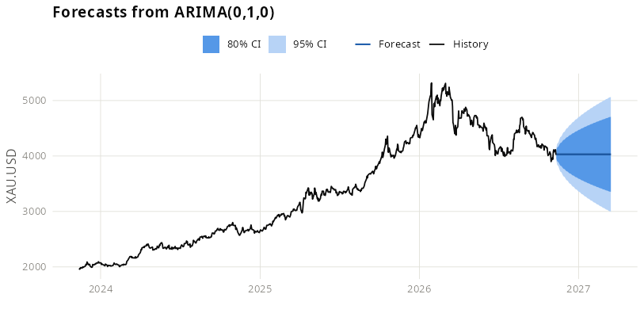

[](https://github.com/EnriquePH/Precious-Metals-Prediction/actions/workflows/r-ci.yml)
[](https://www.gnu.org/licenses/gpl-3.0)

# Precious Metals Price ARIMA Forecast

## Coursera - Developing Data Products

* Author:  Enrique Pérez Herrero
* Date: 20/Dec/2016
* [Email](mailto:eph.project1500@gmail.com)
* [GNU GENERAL PUBLIC LICENSE Version 3, 29 June 2007](https://github.com/EnriquePH/Precious-Metals-Prediction)
* [GitHub url](https://github.com/EnriquePH/Precious-Metals-Prediction)
* [Slidify url](http://enriqueph.github.io/Precious-Metals-Slidify/)

## Description:
The app downloads the last 180 days of prices from [Oanda](http://www.oanda.com)
and forecasts the next 90 days using the `auto.arima` function from the
`forecast` R package.



## Instructions:
[Project gh-pages](http://enriqueph.github.io/Precious-Metals-Prediction/)

## Shiny server Url:
[App url](https://kikesoft.shinyapps.io/Precious-Metals-Prediction)

## Running locally

```r
install.packages(c(
  "shiny", "shinythemes", "DT", "markdown",
  "TTR", "quantmod", "ggplot2", "forecast", "zoo"
))
shiny::runApp(".")
```

## Testing

```r
# from the tests/ directory, or via R CMD check
setwd("tests"); source("testthat.R")
```

Data-fetch tests hit Oanda's live, undocumented metals feed and are skipped
automatically when offline or on CRAN (see `tests/testthat/test-data.R`).

## Linting

Code style is enforced with [lintr](https://lintr.r-lib.org/) using the
rules in [.lintr](.lintr) (the project's own conventions — 4-space indent,
single-quoted strings — rather than tidyverse defaults). Runs on every push
via the same CI workflow.

```r
lintr::lint_dir(".")
```

Functions in [helpers.R](helpers.R) are documented with
[roxygen2](https://roxygen2.r-lib.org/)-style comments (`#'`) describing
parameters and return values, even though this project isn't built as an
installable package with generated `man/` pages.

## Data source

Historical prices are pulled at runtime from
[Oanda](http://www.oanda.com) via `quantmod::getMetals()`. This is an
unofficial, unversioned public endpoint with no published SLA — if Oanda
changes or retires it, `getPreciousMetals()` in [helpers.R](helpers.R) is
the place to point at a replacement feed.

## Citation

See [CITATION.cff](CITATION.cff) for how to cite this software, and the
methodology references below.

* Hyndman, R.J., & Khandakar, Y. (2008). Automatic Time Series Forecasting:
  The forecast Package for R. *Journal of Statistical Software*, 27(3).
  [doi:10.18637/jss.v027.i03](https://doi.org/10.18637/jss.v027.i03)
* Ryan, J.A., & Ulrich, J.M. *quantmod: Quantitative Financial Modelling
  Framework*. [CRAN](https://CRAN.R-project.org/package=quantmod)
* OANDA Corporation. Historical precious metals price data.
  [oanda.com](https://www.oanda.com/)